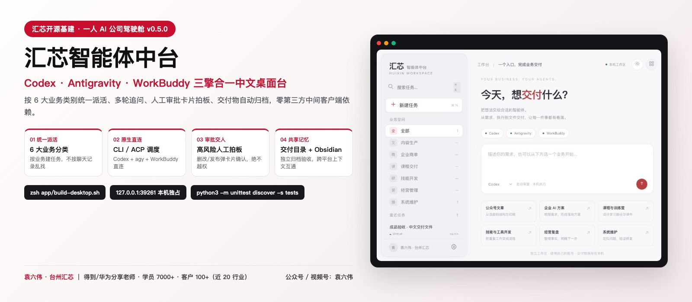
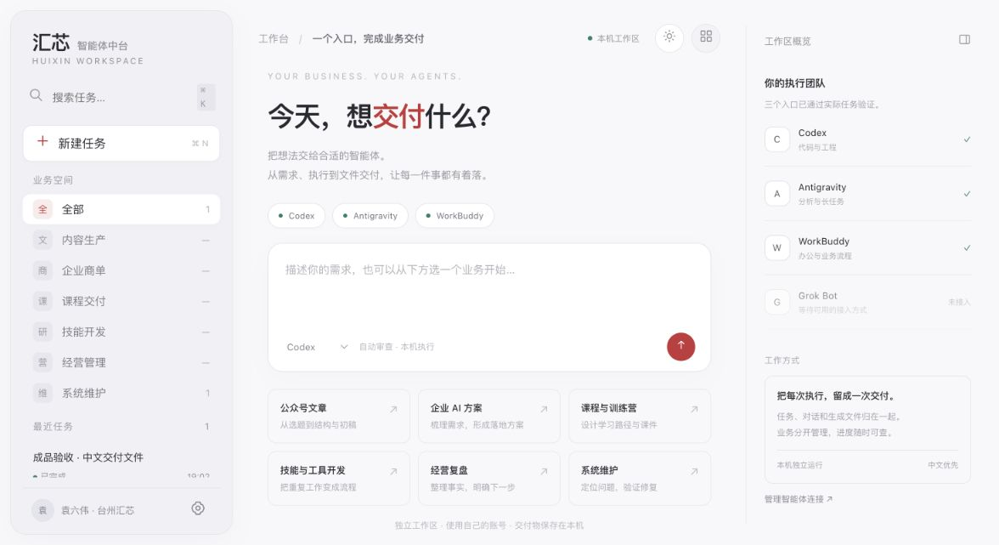
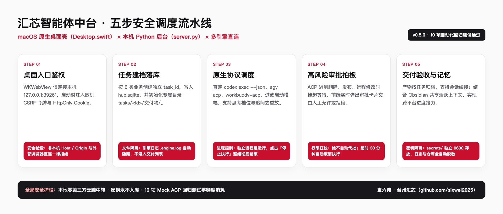

<div align="center">



# 汇芯智能体中台

### Huixin Agent Hub — 面向一人 AI 公司与小团队的多引擎中文桌面工作台

[](https://github.com/sixwei2025/huixin-agent-hub)
[](https://github.com/sixwei2025/huixin-agent-hub)
[](https://github.com/sixwei2025/huixin-agent-hub)
[](LICENSE)

> 🔴 **作者：袁六伟 · 台州汇芯**｜一人 AI 公司创业者，学员 7000+，客户 100+（覆盖近 20 个行业），得到 / 华为分享老师  
> 📮 更多 AI 工具实测与自动化实战，关注 **公众号 / 视频号：袁六伟**

**当前版本**：`v0.5.1` · `2026-11-21`（完整变更见 [CHANGELOG.md](CHANGELOG.md)）

[痛点与对比](#一痛点与正反对比) · [快速开始](#二快速开始与构建) · [架构与审批](#三五步安全调度架构) · [工程坑根治](#四高频工程坑根治) · [目录与边界](#五目录结构测试与诚实边界)

</div>

---

## 新手安装：把链接发给 AI

打开 **Codex、WorkBuddy**，或其他支持读取仓库、执行本地终端命令与技能安装的 AI 智能体，把下面这段话发到对话框，让它帮你克隆仓库并构建桌面应用：

```text
帮我安装这个仓库里的桌面应用与配套技能：
https://github.com/sixwei2025/huixin-agent-hub
```

> 说明：本仓库以 **macOS 桌面应用源码** 为主，并附带配套安装引导 [SKILL.md](SKILL.md)。仅安装 Skill 不会自动生成桌面应用，需要由 AI 或你本人在本机执行 `zsh app/build-desktop.sh` 编译生成 `汇芯智能体中台.app` 后拖入 `/Applications/` 使用。安装完成后可以继续问 AI：「**这个技能怎么用？帮我检查本机 Codex / Antigravity / WorkBuddy 引擎并跑通第一个任务。**」

也可以通过命令行安装配套 Skill 或克隆完整源码：

```bash
# 仅安装配套安装引导 Skill
npx skills add sixwei2025/huixin-agent-hub

# 克隆完整源码到本地构建桌面应用
git clone https://github.com/sixwei2025/huixin-agent-hub.git
```

---

## 一、痛点与正反对比

一个人同时用 Codex、Antigravity、WorkBuddy 干活，最累的不是 AI 不会写，而是**窗口来回切、会话一多就乱、交稿找不到文件、高风险操作不敢放手**。

| 传统多客户端分散使用 | 汇芯智能体中台（本仓库） |
| --- | --- |
| 按「聊天会话」平铺，业务一多根本翻不到 | 按 **6 类业务** 组织：内容生产、企业商单、课程交付、技能开发、经营管理、系统维护 |
| 依赖第三方桌面客户端转发，对方升级或停更就断 | **直接对接官方 CLI 与 ACP 协议**（`codex exec --json`、`agy acp`、`workbuddy-acp`），零中间客户端依赖 |
| 回复结束就算完，产物散落在各处临时目录 | 每个任务自动建立独立目录 `tasks/<id>/交付物/`，按文件验收、原始需求留档 |
| 审批要切回原软件里点，或者干脆盲目全自动 | 高风险操作（删除、发布、远程修改）**直接在对话区弹出审批卡片**，人工允许/拒绝/取消 |
| 三个平台各聊各的，上下文完全割裂 | 支持接入 **Obsidian 共享工作记忆**（[AGENTS.md](AGENTS.md)），跨平台接力直接对齐进度 |

<div align="center">
  
</div>

---

## 二、快速开始与构建

### 环境前提
- macOS（已安装 Xcode Command Line Tools，含 `swiftc`）与 Python 3.10+
- 本机至少已安装并登录以下任意一个执行引擎：
  - **Codex CLI**（`codex`）
  - **Antigravity CLI**（`agy`）
  - **WorkBuddy**（配合 `~/.local/share/huixin-agent-hub/secrets/workbuddy-api-key`）

### 构建与启动

```bash
git clone https://github.com/sixwei2025/huixin-agent-hub.git
cd huixin-agent-hub

# 1. 先跑自动化回归测试（使用 Mock 智能体，不消耗模型额度）
python3 -m unittest discover -s tests -v

# 2. 构建 macOS 原生桌面应用（生成 汇芯智能体中台.app）
zsh app/build-desktop.sh
```

将生成的 `汇芯智能体中台.app` 复制到 `/Applications/` 后打开，即可在中文桌面窗口里选择业务类别、执行引擎与模型，直接派活与验收交付物。

---

## 三、五步安全调度架构



| 步骤 | 核心模块 | 关键动作 | 安全与质量门禁 |
| --- | --- | --- | --- |
| 1. 桌面入口 | `app/Desktop.swift` | macOS `WKWebView` 启动本机后台并注入随机 CSRF 令牌 | 仅监听 `127.0.0.1:39261`，校验 Host、Origin、HttpOnly Cookie 与请求令牌 |
| 2. 任务建档 | `app/server.py` | 按业务分类创建 `task_id`，写入 `hub.sqlite` | 自动初始化 `tasks/<id>/交付物/`，隐藏 `.engine.log` 不混入交付列表 |
| 3. 协议调度 | `app/server.py` + `bin/` | 启动 `codex exec --json` 或 ACP JSON-RPC 2.0 会话 | `bin/acp_stdio_bridge.py` 过滤启动横幅；独立进程组运行，停止即整组结束 |
| 4. 审批拍板 | `app/web/index.html` | 拦截 ACP `session/request_permission` 请求并挂起 | 绝不自动批准高风险操作；前端弹卡片确认，超时 30 分钟自动取消 |
| 5. 归档与记忆 | `workspace/` + Obsidian | 交付物落盘验收，支持 `session/load` 多轮追问 | `secrets/` 0600 独立存放，日志与仓库脱敏；可对接 Obsidian 共享上下文 |

---

## 四、高频工程坑根治

1. **审批权必须交还给人**：ACP 在 `auto` 模式下会自动执行常规编辑，但遇到删除、发布、远程修改等请求时，中台会将其原样挂起并弹出审批卡片，绝不替人静默放行。
2. **多轮追问不再混入历史重放**：ACP `session/load` 恢复会话时会重放历史消息；中台在重放阶段关闭 chunk 收集，只收集本次提问之后的新回复，彻底根治「回复串台」。
3. **停止执行真正杀掉子进程组**：每个任务以独立进程组（`start_new_session=True`）启动，点击「停止执行」或等待审批时取消，都会彻底结束整组进程，不留僵尸后台。
4. **旧会话断线自动无缝续接**：遇到历史遗留会话编号或 `session/load` 失败时，自动打包最近对话历史新建会话接力，不让用户丢上下文。

---

## 五、目录结构、测试与诚实边界

```text
huixin-agent-hub/
├── README.md                    # 项目说明（本文件）
├── SKILL.md                     # 配套安装与使用引导 Skill（兼容 npx skills add）
├── CHANGELOG.md                 # 版本变更记录
├── LICENSE                      # MIT 开源协议
├── AGENTS.md                    # 业务工作区与共享上下文规范
├── app/
│   ├── server.py                # 本机 Python 后台与多引擎调度器（纯标准库，无第三方依赖）
│   ├── web/index.html           # 中文业务工作台前端
│   ├── Desktop.swift            # macOS 原生窗口壳（WKWebView）
│   ├── make-icon.swift          # 汇芯品牌无限标志图标生成
│   └── build-desktop.sh         # 一键编译打包脚本
├── bin/
│   ├── workbuddy-acp            # WorkBuddy ACP 启动适配
│   ├── grokbot-acp              # Grok Bot ACP 启动适配
│   └── acp_stdio_bridge.py      # 标准输入输出协议清理桥接
├── tests/
│   ├── fake_acp.py              # Mock ACP 智能体（零额度消耗）
│   └── test_engine.py           # 10 项核心调度与安全回归测试
└── assets/showcase/             # 品牌头图与流水线架构图
```

### 诚实边界与数据隐私
- 本仓库**仅包含中台源码与安全测试脚手架**，不包含任何个人 `hub.sqlite`、任务交付物、API 密钥、账号凭证或内部知识库内容。
- 界面默认端口仅限本机访问（`127.0.0.1:39261`），普通外部浏览器未带令牌访问会被拒绝。

---

## 致谢

- **T3 Code（[t3dotgg/t3code](https://github.com/t3dotgg/t3code)）**：感谢 T3 Code 开源项目在多智能体本地桌面工作台方向上的先驱探索与工程启发。本项目 `v0.1.0`–`v0.3.0` 曾依托官方 T3 Code 跑通 Codex / Antigravity / WorkBuddy 本机协议联调；自 `v0.4.0` 起执行层已完全自研独立，当前代码库不包含、也不依赖 T3 Code 代码。
- **T3 星尘版（[zds-xiaoxin/xiaoxin-t3code](https://github.com/zds-xiaoxin/xiaoxin-t3code) · MIT）**：中文工作台界面布局与交互参考了该项目的设计思路。

---

## 关于作者与同系列开源矩阵

**袁六伟 · 台州汇芯**｜一人 AI 公司创业者 · 累计带出实战学员 **7000+** · 服务企业商单客户 **100+**（覆盖近 **20** 个行业）· 得到 / 华为分享老师。  
我们只开源自己每天真实跑通、能落地收钱的 AI 产线与基建工具。关注 **公众号 / 视频号：袁六伟**。

| 项目 | 定位与用途 |
| --- | --- |
| [汇芯智能体中台](https://github.com/sixwei2025/huixin-agent-hub) | **本仓库**：Codex / Antigravity / WorkBuddy 三擎合一中文桌面工作台 |
| [汇芯技能管家](https://github.com/sixwei2025/huixin-skills-manager) | 本地技能中文浏览、分类与同步管理 |
| [汇芯内容管家](https://github.com/sixwei2025/huixin-content-manager) | 多平台自媒体经营数据与最近内容桌面面板 |
| [汇芯 Token 管家](https://github.com/sixwei2025/huixin-token-manager) | 多模型 API 额度与消耗本地监控 |
| [本地视频中心](https://github.com/sixwei2025/local-video-hub) | 多 AI 员工统一交片与查重面板 |
| [一人公司方法库](https://github.com/sixwei2025/yuanliuwei-ai-skills) | PACT 72 小时验证器与一人 AI 公司决策总库 |
| [《人人都能开发 Skill》](https://github.com/sixwei2025/everyone-can-build-skills) | 85 页全彩图文免费开源新书与实战案例 |
| [公众号全自动总控](https://github.com/sixwei2025/workbuddy-wechat-autopilot) | 选题查重、真跑实测到直投微信草稿箱 |
| [AI 工具评测产线](https://github.com/sixwei2025/ai-tool-review-wechat-skill) | 真实工具横评与实操截图公众号流水线 |
| [公众号封面引擎](https://github.com/sixwei2025/wechat-cover-skill) | 汇芯红 6 套杂志风封面与防压脸校验 |
| [百万阅读排版](https://github.com/sixwei2025/gzh-million-layout-skill) | 零乱码内联 CSS 手机端阅读骨架 |
| [实操教程视频](https://github.com/sixwei2025/auto-tutorial-skill) | 自动推拉运镜与红框聚焦教学视频 |
| [真人口播视频](https://github.com/sixwei2025/talking-head-video-skill) | 真人口播克隆配音与竖版封面流水线 |
